<div align="center">


# 智观 BI · Insight Knowledge BI

> **用对话，看懂你的数据。**
> 一个 AI 原生的源码可见 BI 平台 —— 自然语言问数、SQL 智能助写、指标分析、看板编排、数据大屏与行级安全，
> **全部装进一个 Go 二进制**里。

[](https://go.dev)
[](https://react.dev)
[](https://www.typescriptlang.org)
[](https://docs.docker.com/compose/)
[](#参与贡献)
[](LICENSE)

**[中文](README.md)** ｜ **[English](README_EN.md)**

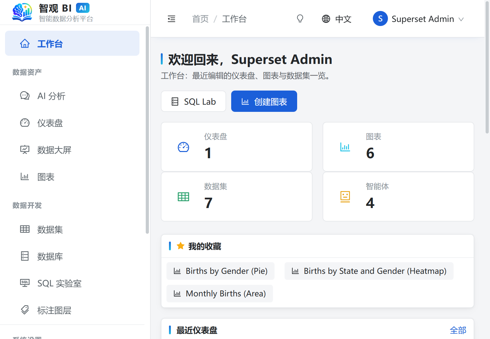

<sub>工作台：最近编辑的仪表盘、图表与数据集一览，左侧按「数据资产 / 数据开发 / 系统设置」分组。</sub>

</div>

---

## ⚡ 三分钟启动

需要 **Docker** + **Go 1.22+** + **Node 18+**。

```bash
git clone https://github.com/jeokeo011222/Insight-knowledge-BI.git
cd Insight-knowledge-BI/scripts
./start.sh              # Windows 用 start.bat 或 powershell -File start.ps1
```

脚本**幂等**（已在跑的部分自动跳过），完成后打开 **http://localhost:3000**，用 **`admin` / `admin`** 登录。

| 操作 | Windows | Linux / macOS |
|---|---|---|
| 启动 | `scripts\start.bat` \| `start.ps1` | `./scripts/start.sh` |
| 停止 | `scripts\stop.bat` | `./scripts/stop.sh` |
| 重启 | `scripts\restart.bat` | `./scripts/restart.sh` |

想跳过脚本手动跑？看 [快速开始](#快速开始)。

---

## ✨ 亮点

| | 亮点 | 一句话 |
|---|---|---|
| 🤖 | **Agent 推理过程可审计** | 规划 → 调工具 → 观察 → 作答 闭环，SSE 流式回放每一步 |
| 🛡️ | **四层护栏 + 写前快照** | 步数 / 工具数 / Token 预算 / 超时；写工具可按 run 回滚 |
| 🔒 | **默认只读，越权即拒绝** | SQL 词法守卫 + RLS + 列级脱敏 + 会话级只读 |
| 📊 | **80+ 可视化类型** | 时间序列 / 矩阵透视 / KPI / 地理 / 高级类型（K 线、甘特、平行坐标…） |
| 🧩 | **三种取数，一个出口** | DB 直连 60+ 引擎、Excel/CSV（含 `.xls`）、HTTP/API |
| 🖥️ | **看板 + 大屏都能绑数据集** | 仪表盘原生过滤器、模板导出；大屏组件可直绑数据集 |
| 🧭 | **指标口径统一 + 归因分解** | 语义层注入提示词；归因用程序算 `share / cum_share` 杜绝口算误差 |
| 🔁 | **同题同答案 93.6%** | 低温 + SQL 规范化 + 回答记忆，重复提问 0 token |
| 🧠 | **智能路由：成本分级** | 单指标读走廉价 fast model，归因/趋势/写操作走完整 reasoning |
| 📈 | **Pulse 主动洞察** | 指标订阅 + 异常检测 + LLM 写摘要 + Slack/邮件推送 |
| 🔌 | **MCP 协议支持** | 把问数能力挂到 Claude Code / Cursor / 任何 MCP 宿主 |
| 🎯 | **骨架屏 + 响应式** | 首屏不闪白，手机自动折叠 Drawer + 单列看板 |

---

## 🎯 和主流 BI 的差异化

| 能力 | 智观 BI | Apache Superset | 字节 Quick BI | Tableau |
|---|---|---|---|---|
| 自然语言问数 + SQL 生成 | ✅ 可审计 SSE | ❌ 无 Agent | ✅ 小Q，但闭源 | ❌ 需 Tableau GPT（付费） |
| 默认只读 + 写前快照回滚 | ✅ | ❌ SQL Lab 默认写 | ❌ | ✅（但非 Agent 链路） |
| 成本分级路由（fast vs full model） | ✅ | ❌ | ❌ | ❌ |
| Pulse 主动洞察 | ✅ 自建 | ❌ | ✅ 但闭源 | ✅ Pulse（付费） |
| MCP 协议对外暴露能力 | ✅ 原生 | ❌ | ❌ | ❌ |
| 三种取数 → 统一数据集出口 | ✅ | ⚠️ 需扩展 | ⚠️ 有限 | ✅ |
| 单二进制部署 | ✅ Go 1 个二进制 | ❌ Python 微服务 | ❌ | ❌ |
| 源码可见 | ✅ PolyForm | ✅ Apache 2.0 | ❌ 闭源 | ❌ 闭源 |
| 纯前端可视化类型 | 80+ | 30+ | 60+ | 100+（付费） |

---

## 🧩 功能详解

### AI 分析：会解释自己的答案

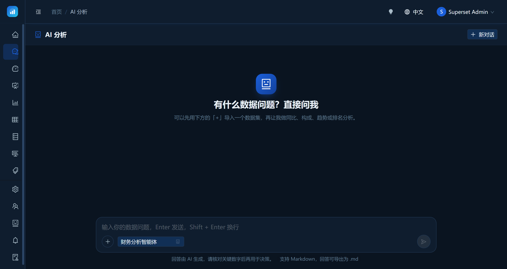

提问即取数。Agent 看表、看字段、对齐口径、生成只读 SQL、结果动态截断后入模 —— 答不下去时回到规划继续补信息。

**规划 → 执行 → 观察 → 作答** 四步闭环，SSE 流式推送给前端，每一步都能回放、可审计、可回滚。

<div align="center">
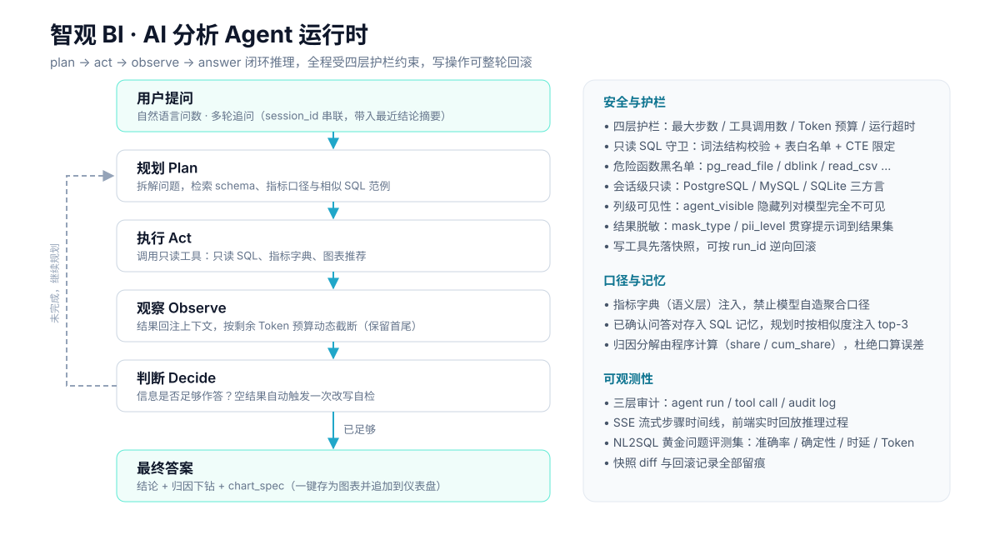
</div>

### 数据集：三种来源，一个出口

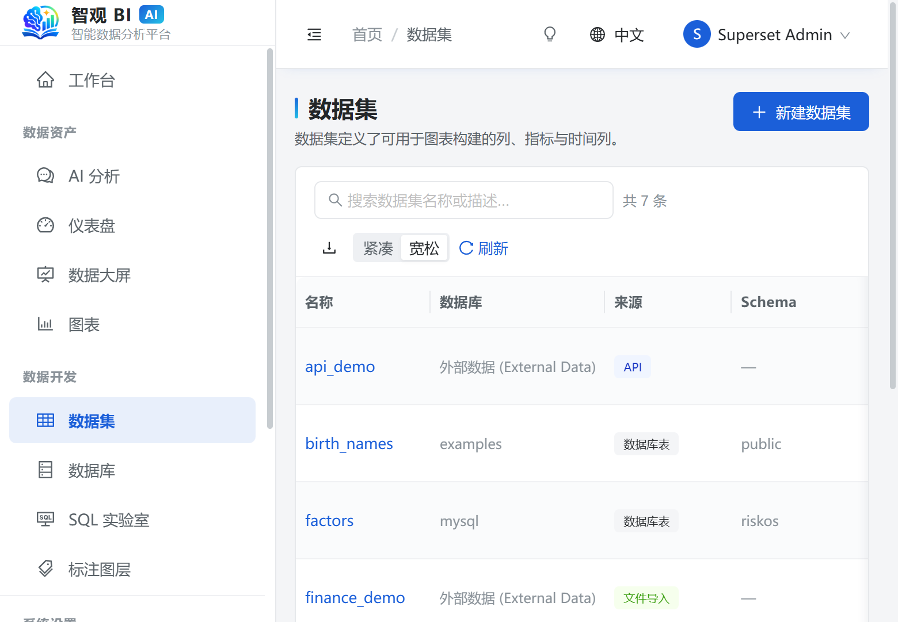

- **数据库直连**（60+ 引擎，下推查询，不落库）
- **Excel / CSV 导入**（`.xls` OLE2 魔数识别，多 sheet 勾选，默认只选第一个）
- **HTTP / API 接口**（超时 + 大小 + 行数三重上限，凭据加密不回显）

后两者物化成托管 SQLite 表后，下游查询、图表、探索、RLS **只有一份实现**。

<div align="center">
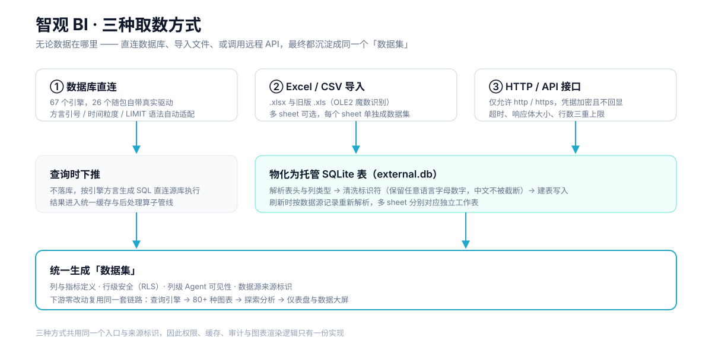
</div>

### 探索分析 + 80+ 可视化图库

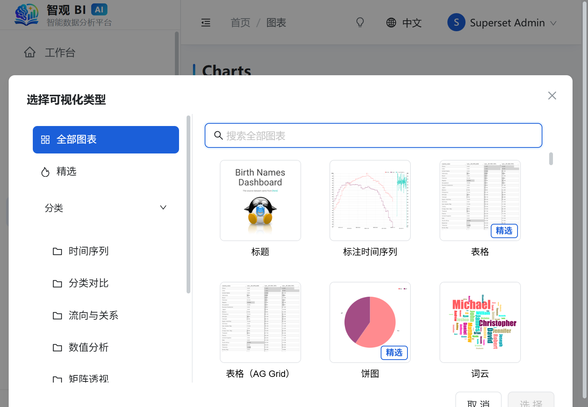

左侧选指标、右侧实时预览，底部原始数据。点开「查看全部图表」弹出可搜索、可按标签筛选的图库。

### 仪表盘与数据大屏

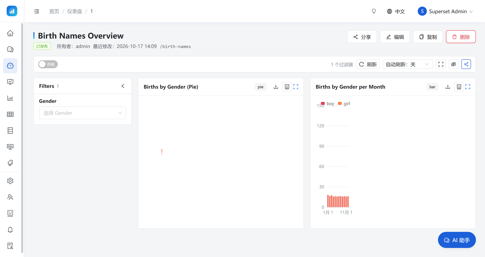

行/标签页布局、拖拽调整、原生过滤器、自动刷新（默认关闭）、一键导入导出模板。

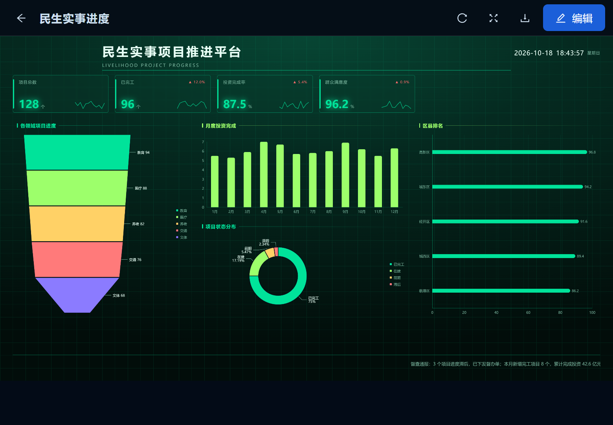

大屏每个数据组件都能绑定**数据集**（不仅仅是已保存图表）。

### 权限 + AI 治理

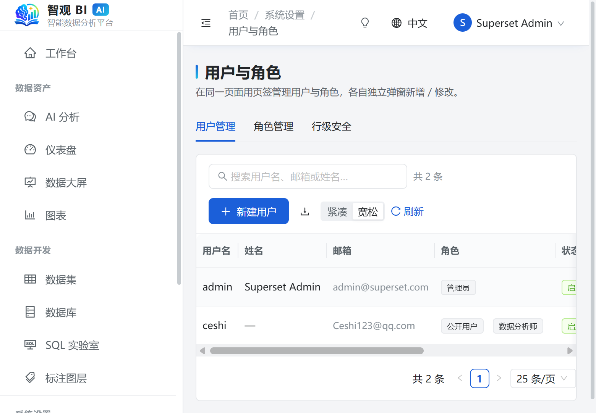

内置五个角色（管理员 / 分析师 / 查看者 / SQL 用户 / 公开用户），内置不可改不可删但权限可配。

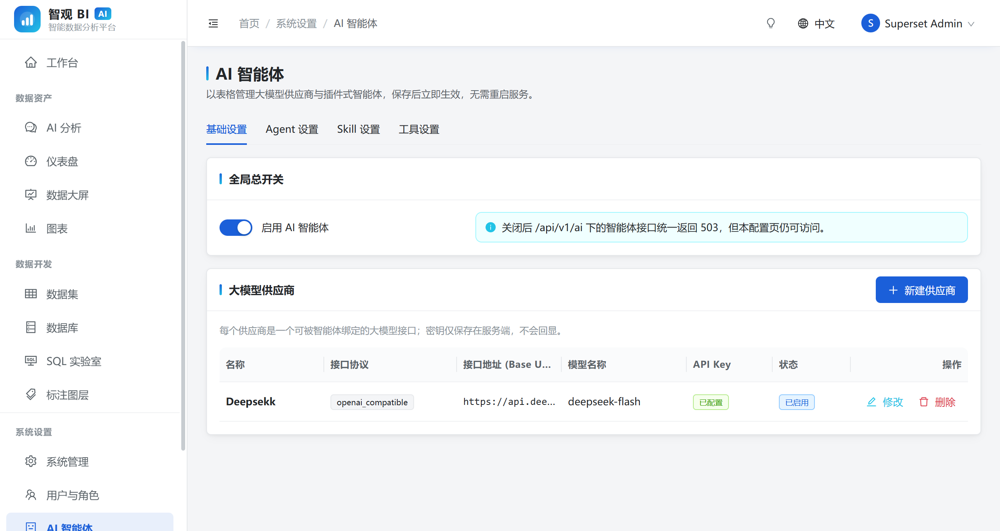

AI 供应商、Agent、Skill、工具四张表分开治理。供应商 API Key **只写不读**。内置 Agent/Skill/工具是**只读**的。审计日志分「系统操作」与「AI 调用」。

---

## 🔌 MCP：把 BI 接到别的 Agent 上

除了内置 Agent，取数能力也可以挂到外部 MCP 客户端（Claude Code、Cursor、任何支持 MCP 的宿主）：

```bash
./superset-dev mcp            # stdio JSON-RPC
```

```json
{
  "mcpServers": {
    "zhiguan-bi": {
      "command": "/path/to/superset-dev",
      "args": ["mcp"],
      "env": {
        "SUPERSET_MCP_URL": "http://localhost:8088",
        "SUPERSET_MCP_USERNAME": "admin",
        "SUPERSET_MCP_PASSWORD": "admin"
      }
    }
  }
}
```

暴露 **5 个只读工具**：`list_datasets` · `describe_dataset` · `dry_plan` · `semantic_query` · `run_sql`。

每个 MCP 调用都以真实用户身份执行 —— 权限、RLS、脱敏、SQL 守卫全部生效，不存在旁路。

语义模型支持 [OSI 0.2.0](https://github.com/open-semantic-interchange/OSI) 导入导出，换 BI 工具不用重建指标。

---

## 🏗️ 系统架构

<div align="center">
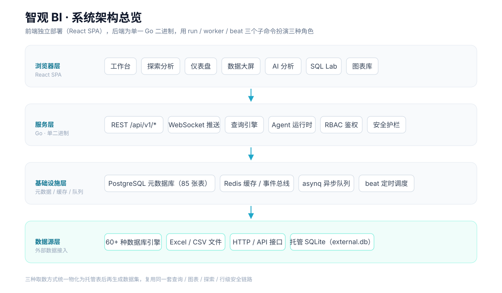
</div>

**单一 Go 二进制**，三个子命令三种角色：

```bash
./superset-dev run      # HTTP API + WebSocket + Agent 运行时
./superset-dev worker   # asynq 异步队列（缩略图、报表、导出）
./superset-dev beat     # 定时调度（告警、Pulse、定时报告）
```

元数据库 **85 张表**，启动时自动迁移（幂等）。

---

## 快速开始（进阶）

### 示例数据

| 内容 | 来源 | 说明 |
|---|---|---|
| 5 个内置角色及权限 | 建表自动播种 | 管理员 / 分析师 / 查看者 / SQL 用户 / 公开用户 |
| 2 个主题（默认 / 暗色） | 建表自动播种 | 可改 |
| RLS + 标注示例 | 建表自动播种 | 未关联角色，不影响既有查询 |
| 4 个大屏模板 | 代码内置 | 新建大屏可选 |
| birth_names 数据集 + 6 张图 + 看板 | `load-examples` | 启动脚本已自动执行 |

单独跑（幂等）：
```bash
./superset-dev.exe load-examples
```

### 手工启动（不想用脚本）

```bash
docker compose -f docker/docker-compose.yml up -d

cd backend && go build -o superset-dev.exe ./cmd/superset
./superset-dev.exe db upgrade
./superset-dev.exe load-examples   # 可选

./superset-dev.exe run &
./superset-dev.exe worker &
./superset-dev.exe beat &

cd frontend && pnpm install && pnpm run dev
```

---

## 🧰 技术栈

| 层 | 选型 |
|---|---|
| 后端 | Go 1.26 · Cobra · `net/http` · JWT · SSE · asynq |
| 元数据 | PostgreSQL（85 张表，自动迁移） |
| 缓存 / 队列 | Redis |
| 前端 | React 18 · TS 5.7 · Vite 6 · Redux Toolkit 2 · react-router 6 |
| UI | Ant Design 5 · Apache ECharts 5.6 |
| 部署 | Docker Compose |
| CI | GitHub Actions（build + vet + test + tsc + dry-evals） |

## 📁 目录结构

```
superset-go/
├── backend/                    Go 后端（单一二进制，run / worker / beat）
│   ├── cmd/superset/           入口
│   └── internal/
│       ├── ai/                 Agent 运行时 · 规划器 · 护栏 · Pulse
│       ├── api/                HTTP 路由
│       ├── connectors/         60+ 引擎方言
│       ├── ingest/             文件 / HTTP 取数
│       ├── queries/            查询引擎 · EXPLAIN 成本闸 · RLS
│       ├── security/           RBAC · RLS · 脱敏
│       └── models/             85 张表
├── frontend/                   React + TS
│   └── src/
│       ├── components/         图表渲染 · AI 面板 · 骨架屏
│       ├── pages/
│       └── i18n/               中英双语
├── docker/                     docker-compose.yml
├── .github/workflows/          CI（build + vet + test + dry-evals）
├── docs/
│   ├── images/
│   ├── golden_questions.json   NL2SQL 评测集 50 题
│   └── eval_nl2sql.py          评测脚本
└── scripts/                    start / stop / restart
```

---

## ❓ 常见问题

<details>
<summary><b>某个菜单项不见了？</b></summary>
菜单按权限渲染。去「用户与角色 → 角色管理」补权限即可。
</details>

<details>
<summary><b>后端改了代码但 404？</b></summary>
旧进程还在跑。`scripts\restart.bat`（或 `./scripts/restart.sh`）重新编译并重启。
</details>

<details>
<summary><b>图表显示「暂无数据」？</b></summary>
数据集本身没数据或时间范围被过滤掉了。先到数据集页预览原始行，再去 Explore 放宽条件。
</details>

<details>
<summary><b>AI 分析报 Token 预算不足？</b></summary>
「AI 智能体设置 → Agent 设置」放宽护栏。绑定数据集时指标字典不做条数截断。
</details>

<details>
<summary><b>想彻底重置？</b></summary>
`scripts\stop.ps1 -IncludeInfra` 连容器一起停，再 `docker compose -f docker/docker-compose.yml down -v` 删数据卷。
</details>

<details>
<summary><b>登录页在哪？</b></summary>
单二进制默认在 **http://localhost:3000** 自动弹出登录页，`admin` / `admin`。
</details>

---

## 🗺️ 路线图

- [ ] 更多图表类型的交互式配置面板
- [ ] Agent 写操作的双向确认与更细粒度回滚展示
- [ ] 数据集增量刷新与调度绑定
- [ ] 单点登录（OIDC / LDAP）
- [ ] NL2SQL 确定性编译器（问题 → spec → SQL）—— 让"同题同答案"从 93.6% 提到 99%+

---

## 🤝 参与贡献

Issue 与 PR 都欢迎。提交前请确保：

```bash
cd backend  && go build ./... && go vet ./... && go test ./... -count=1
cd frontend && npm run typecheck && npm run build
```

NL2SQL 评测集 50 题 + 门禁脚本在 `docs/` 下，PR 里改了 SQL 相关逻辑请一起跑：

```bash
python docs/eval_nl2sql.py --dry          # 只做结构校验，零 LLM 调用
python docs/eval_nl2sql.py --live --repeats 2  # 完整评测（需启动本地服务 + LLM 密钥）
```

---

## 📜 许可说明

本项目的元数据模型、API 语义与部分前端交互，**参照 Apache Superset 6.x 的设计重新实现**，
但代码是独立的 Go / TypeScript 实现，并非其分支。向上游社区致谢。

> **PolyForm Noncommercial License 1.0.0** —— 源码可见，但**仅限非商业用途**。
> 个人学习、科研实验、非营利教育可自由使用、修改与分发；
> SaaS 服务、企业付费业务、外包项目、售卖或集成进商业产品对外分发，
> 须另行取得授权。完整条款见 [LICENSE](LICENSE)。

如果这个项目对你有帮助，欢迎点一个 ⭐ —— 它对开源项目真的很重要。
