<div align="center">


# ZG BI

**Ask your data. Actually understand the answer.**

An AI-native, source-available BI platform — natural-language querying, AI-assisted SQL,
metric analysis, dashboard authoring, data screens and row-level security, all inside
**a single Go binary**.

[](https://go.dev)
[](https://react.dev)
[](https://www.typescriptlang.org)
[](https://ant.design)
[](https://echarts.apache.org)
[](https://www.postgresql.org)
[](https://docs.docker.com/compose/)
[](LICENSE)

**[中文](README.md)** ｜ **[English](README_EN.md)** ｜ **[User Manual](Insight-knowledge-BI-User-Manual.md)** ｜ **[用户手册](智观BI-用户操作手册.md)**

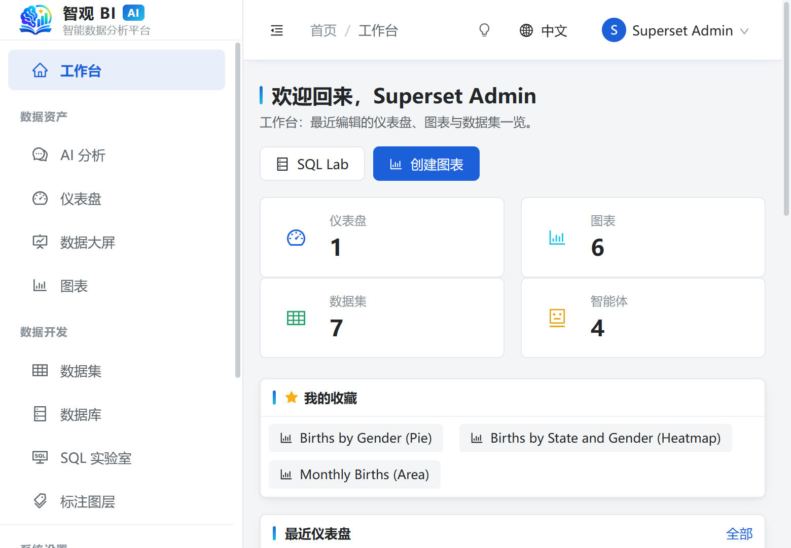

<sub>The workspace: recently edited dashboards, charts and datasets, with the sidebar grouped into Data assets / Data development / System settings.</sub>

</div>

---

## Why another BI tool?

Because almost every BI tool silently assumes you already know *which* table to hit, *which* field to use,
and *what* SQL to write. The people who actually need answers every day — operations, finance, supply chain —
usually get stuck on the very first step:

> "I want to know why the return rate in East China jumped last month."

That sentence is fine. The hard part is translating it into correct SQL.

ZG BI takes a different approach: **put an agent in front of the data.** It finds the tables, reads the
schema, aligns with your metric definitions, generates a read-only query, computes the numbers, and hands
you a conclusion with the drivers behind it — while showing you **every step it took**.

You ask good questions. It makes them trustworthy answers.

## Highlights

| | Highlight | In one line |
|---|---|---|
| 🤖 | **Auditable AI analysis** | plan → act → observe → answer, streamed live; every conclusion, SQL statement and row count is on record |
| 🛡️ | **Four guardrails + snapshots** | max steps / max tool calls / token budget / run timeout; write tools snapshot first and roll back per run |
| 🔒 | **Read-only by default** | read-only SQL guard (lexical checks, table allowlist, dangerous-function blocklist), column-level visibility, result masking, session-level read-only |
| 📊 | **80+ visualizations + gallery** | time series, categorical, matrix/pivot, KPI/gauge, geo, plus candlestick / gantt / horizon / parallel coordinates / butterfly |
| 🧩 | **Three ways in, one way out** | direct DB (60+ engines), Excel/CSV import (incl. legacy `.xls`, multi-sheet), HTTP/API — all land as the same kind of *dataset* |
| 🖥️ | **Screens & dashboards** | dashboards with rows/tabs, native filters, template import/export; every screen widget can bind a saved chart **or** a dataset |
| 🧭 | **One metric definition, everywhere** | semantic-layer metric dictionary is injected into the prompt; attribution maths (`share` / `cum_share`) is computed in code, never by the model |
| 🔁 | **Same question, same answer** | low temperature + a fixed SQL template + statement canonicalization + answer memory: the same question asked twice yields the same SQL 91.5% of the time, up from 6.4% (almost all of it from the answer memory; prompt-only control: 8.7%) |

## Feature tour

### 1 · AI analysis that explains itself

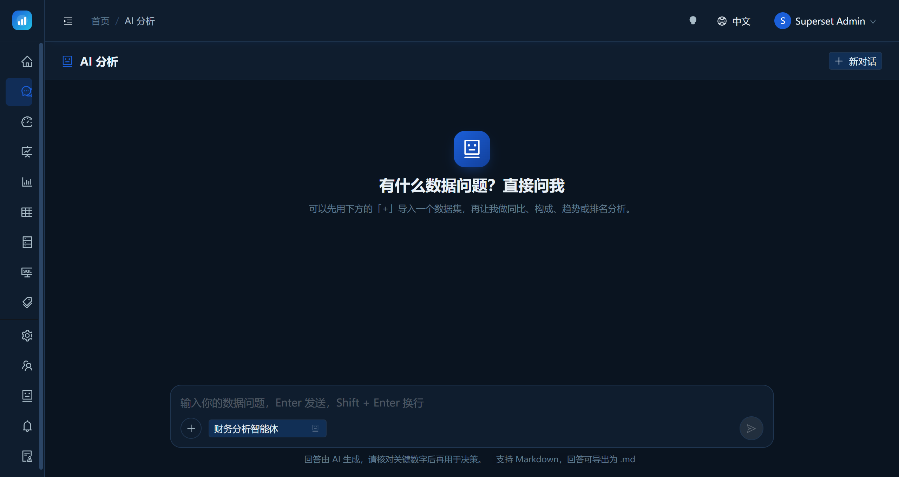

Ask in plain language. The agent first surveys available tables, columns and metric definitions, then decides
which query to run. Results are truncated against the remaining token budget (keeping head and tail), so large
tables still fit safely. If it cannot answer yet, it returns to planning instead of guessing.

**The same question asked twice should give the same answer.** That takes four layers, not luck: planning runs at
temperature 0; the system prompt carries a fixed SQL template (skeleton, aggregate allowlist, alias rules, schema
qualification); every statement is canonicalized before execution (quoting, case, schema prefix,
`COUNT(1)→COUNT(*)`, projection aliases rewritten from their expression); and repeated questions hit the answer
memory — the recorded **SQL is re-executed**, and the answer is reused only if the result fingerprint (row count
plus the sorted set of rows) still matches. Data moved, so the run is regenerated. Across 50 questions × 2 runs,
"two runs, same SQL" went from 6.4% to 91.5%, and repeated questions cost 0 tokens.
To be honest about where it comes from: almost all of that is the answer memory. With replay switched off, temperature 0 + the SQL
template + canonicalization alone measure 8.7% — so the claim is "repeat questions are reproducible", not "the model always writes
the same SQL". The latter needs a deterministic compiler (question → spec → SQL), which is not built yet.

<div align="center">
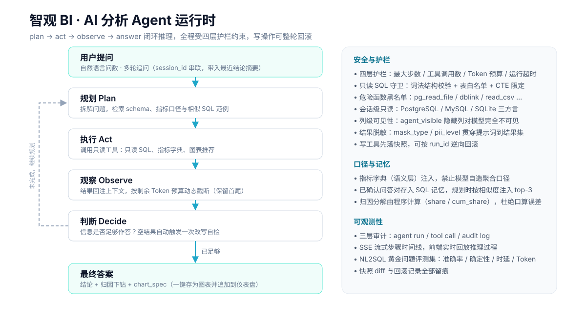
</div>

### 2 · Datasets: wherever the data lives, it enters through one door

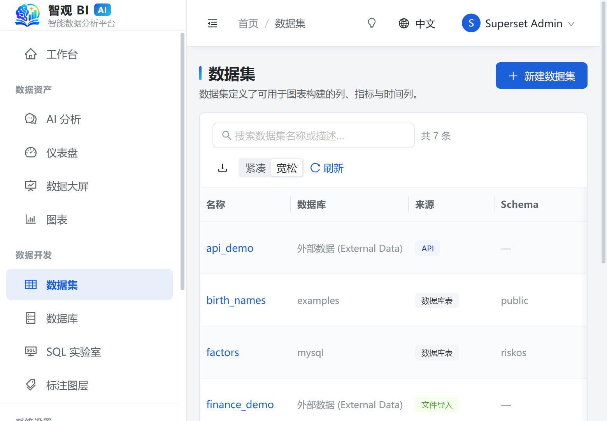

- **Direct connection** — pushdown at query time, nothing is copied; dialect quoting, time grains and `LIMIT` syntax adapted per engine.
- **Excel / CSV import** — both modern `.xlsx` and legacy `.xls` (detected by OLE2 magic number, not file extension). Multi-sheet workbooks prompt you to choose, and **only the first sheet is selected by default** so you never create a pile of datasets by accident.
- **HTTP / API** — `http` / `https` only, with timeouts plus response-size and row-count caps; credentials are encrypted and **never echoed back**.

The last two are materialised into a managed SQLite store (`external.db`) before becoming datasets, so querying,
charts, exploration and row-level security all share **a single implementation**.

<div align="center">
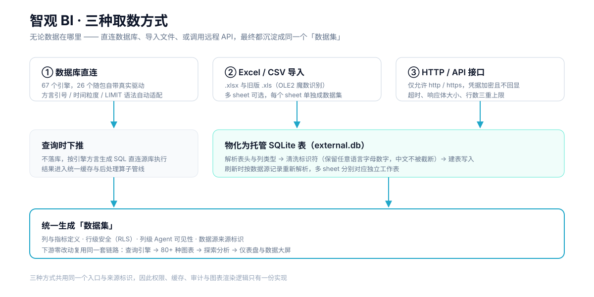
</div>

### 3 · Explore and the visualization gallery

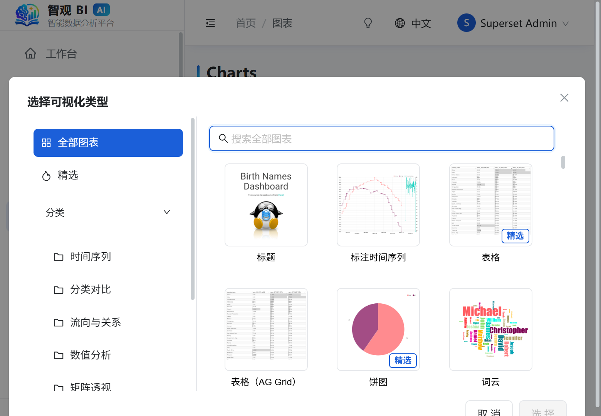

Pick a dataset and metrics on the left, preview in the middle, inspect raw rows at the bottom. Click
"View all charts" and a searchable, tag-filtered (**Featured** / **Advanced**) gallery opens with 80+ types.

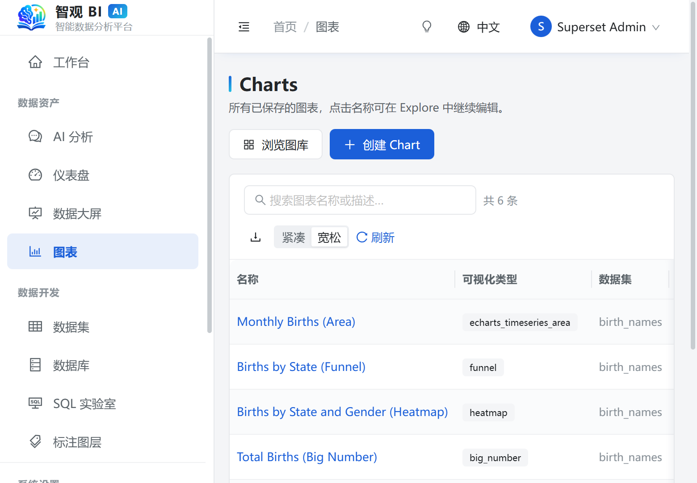

### 4 · Dashboards and data screens

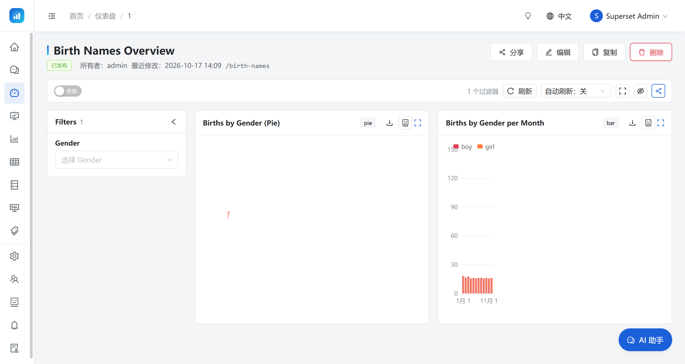

Rows and tabs, drag-and-drop resizing, native filters, an auto-refresh interval selector that is
**off by default** (we do not auto-refresh behind your back), and one-click template export/import.

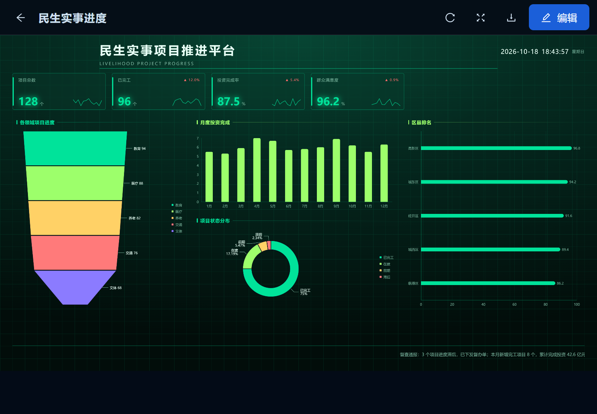

Screens support chart, KPI card, table, leaderboard and progress widgets. **Any data widget can bind a dataset
directly** — not only a saved chart.

### 5 · Access control, AI governance and observability

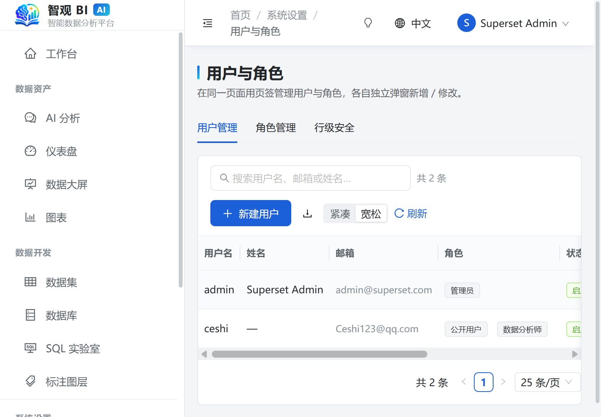

Users, roles and row-level security are three tabs of one page. Five built-in roles ship out of the box —
**Admin / Analyst / Viewer / SQL User / Public** — built-in roles cannot be renamed or deleted, but their
permission set is fully editable.

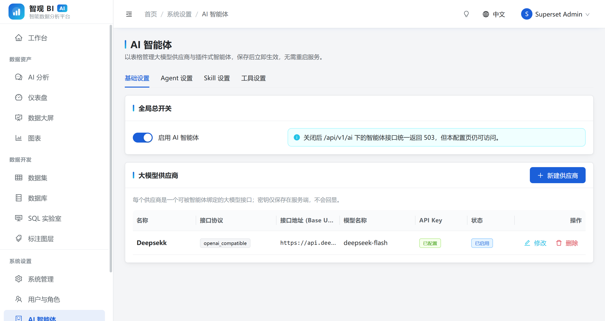

Providers, Agents, Skills and Tools are governed in four separate tables. Provider API keys are
**write-only** — the API returns only a boolean "is configured". Built-in agents, skills and tools are
**read-only**; only your own instances can be edited or deleted.

The audit log splits into **system operations** and **AI calls**: every agent run and every tool invocation is recorded.

## Plug the BI into another agent (MCP)

Beyond the built-in agent, the retrieval path can be attached to any MCP client
(Claude Code, Cursor, or any Model Context Protocol host):

```bash
./superset-dev mcp            # stdio JSON-RPC, launched by the MCP host
```

Point the client at it with three environment variables:

```json
{
  "mcpServers": {
    "superset-bi": {
      "command": "/path/to/superset-dev",
      "args": ["mcp"],
      "env": {
        "SUPERSET_MCP_URL": "http://localhost:8088",
        "SUPERSET_MCP_USERNAME": "admin",
        "SUPERSET_MCP_PASSWORD": "admin"
      }
    }
  }
}
```

`SUPERSET_MCP_TOKEN` works too. The five exposed tools are **read-only**:
`list_datasets`, `describe_dataset`, `dry_plan`, `semantic_query`, `run_sql`.

The MCP process is a thin client of the REST API, so **every call runs as a real
user**: permissions, row-level security, column masking, the SQL guard and the
row cap all still apply — there is no side door.

Semantic models also import/export as [OSI](https://github.com/open-semantic-interchange/OSI)
0.2.0 (dataset → semantic model → `OSI` / `Import OSI`), so metrics survive a
move to another BI tool.

## Architecture

<div align="center">
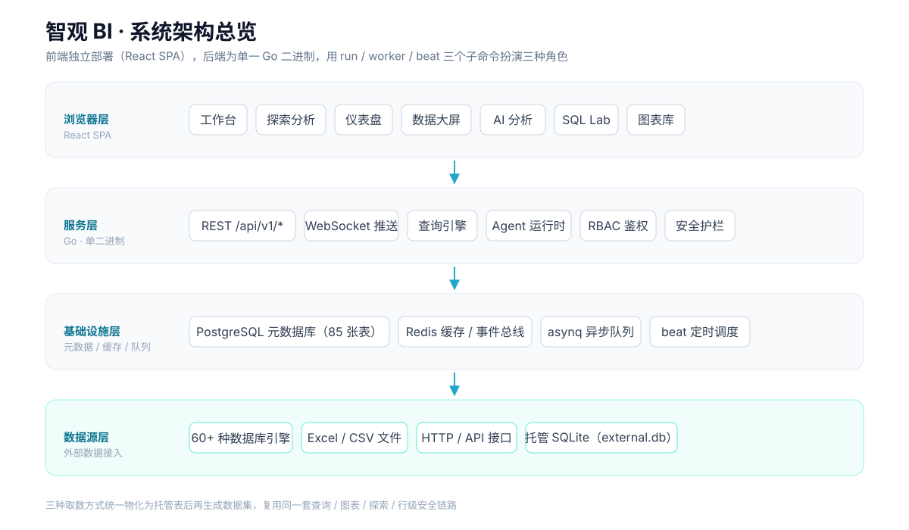
</div>

The backend is a **single binary** playing three roles:

```bash
./superset-dev run      # HTTP API + WebSocket + agent runtime
./superset-dev worker   # asynq queue consumers (thumbnails, reports, exports)
./superset-dev beat     # scheduled jobs (alerts and scheduled reports)
```

All 85 metadata tables are created by an idempotent migration on startup.

## Quick start

**Requirements**: Docker, Go 1.22+, Node.js 18+.

```bash
git clone https://github.com/jeokeo011222/Insight-knowledge-BI.git
cd Insight-knowledge-BI/scripts
./start.sh              # on Windows use start.bat or: powershell -File start.ps1
```

The script is **idempotent** — anything already running is skipped. It will:

1. start the PostgreSQL (5533) and Redis (6379) containers
2. build the backend binary
3. migrate the metadata database (tables + role/permission seeds)
4. launch `run` / `worker` / `beat`
5. start the frontend dev server

Then open **http://localhost:3000** and log in with **`admin` / `admin`**.

### Lifecycle scripts

| Action | Windows | Linux / macOS | Notes |
|---|---|---|---|
| Start | `scripts\start.bat` \| `scripts\start.ps1` | `./scripts/start.sh` | idempotent, safe to re-run |
| Stop | `scripts\stop.bat` \| `scripts\stop.ps1` | `./scripts/stop.sh` | stops the app, keeps DB containers |
| Restart | `scripts\restart.bat` \| `scripts\restart.ps1` | `./scripts/restart.sh` | ≈ stop then start |

| Flag | Effect |
|---|---|
| `-SkipInfra` | skip containers, use your own database / Redis |
| `-SkipBuild` | skip compilation, just restart processes |
| `-SkipFrontend` | leave the frontend dev server alone |
| `-IncludeInfra` | (stop only) also stop the database containers |

## Tech stack

| Layer | Choice |
|---|---|
| Backend | Go 1.26 · Cobra CLI · `net/http` · JWT · SSE · asynq |
| Metadata | PostgreSQL (85 tables, auto-migrated on startup) |
| Cache / queue | Redis (cache, event bus, background jobs) |
| Frontend | React 18 · TypeScript 5.7 · Vite 6 · Redux Toolkit 2 · react-router 6 |
| UI | Ant Design 5 · Apache ECharts 5.6 |
| Deployment | Docker Compose (PostgreSQL + Redis) |
| i18n | Fully aligned Chinese / English message packs |

## Documentation

- [ZG BI User Manual (EN)](Insight-knowledge-BI-User-Manual.md)
- [智观 BI 用户操作手册 (中文)](智观BI-用户操作手册.md)

## Notes, licensing and acknowledgements

The metadata model, API semantics and parts of the frontend interaction are a **clean-room reimplementation
inspired by Apache Superset 6.x** — the code is an independent Go / TypeScript implementation, not a fork.
Thanks to the upstream community.

> This project is licensed under the **PolyForm Noncommercial License 1.0.0** — source-available,
> but **noncommercial use only**. Personal study, research and non-profit education are free to use,
> modify and distribute. Commercial use — SaaS offerings, paid enterprise services, outsourcing,
> resale, or embedding into a commercial product — requires a separate license.
> See [LICENSE](LICENSE) for the full terms.

If this project helps you, a ⭐ goes a long way.
